# Kanaf (כנף)

[](https://swift.org)
[](https://developer.apple.com)
[](LICENSE)

Kanaf (Hebrew: כנף, "wing") is a free, open-source VFR Electronic Flight Bag for iPad and iPhone, for the US and Israel (CVFR): a moving map on the FAA sectional or the Israeli CVFR network, airport and weather information, flight recording, and an on-device post-flight debrief. The App Store name is "Kanaf EFB". Internal identifiers still say openefb/efb-212 (repo name, Xcode target, bundle ID `io.omer.efb`, server names).

**Status: TestFlight beta (version 1.0, build 1).** See [Limitations](#limitations).

## Screenshots

iPad Pro 13-inch and iPhone 17 Pro simulators, beta build. The Israel shots show Kanaf's own vector CVFR overlay on the Street base map; the official CAAI chart raster is not shown here.

<table>
  <tr>
    <td align="center">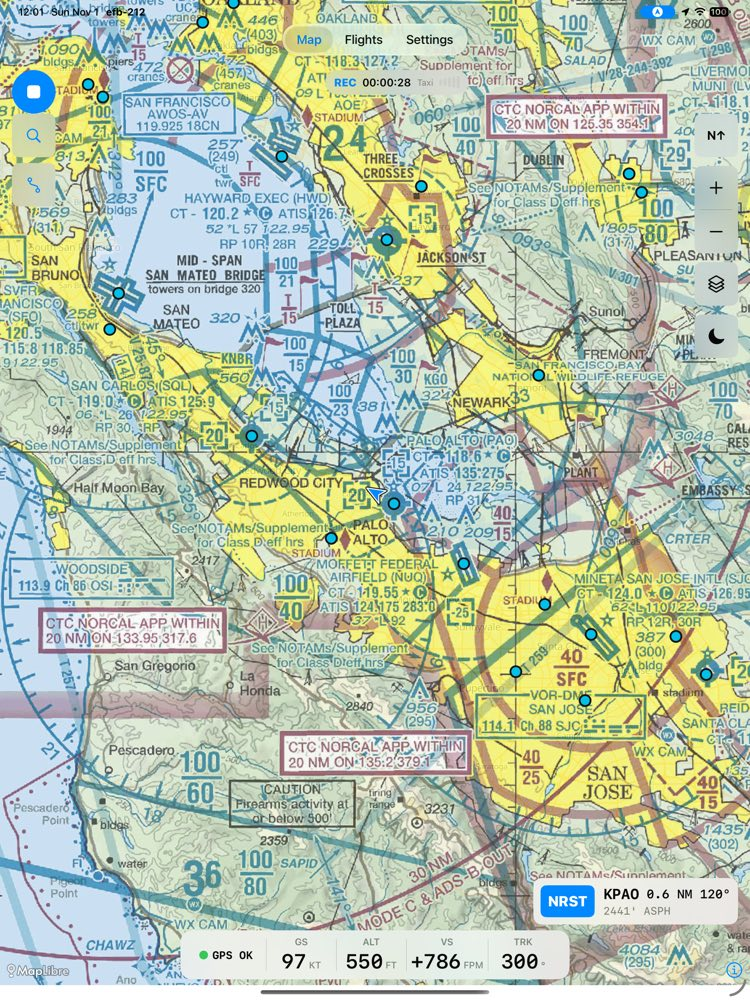<br>US: moving map on the FAA sectional, recording, NRST readout and instrument strip</td>
    <td align="center">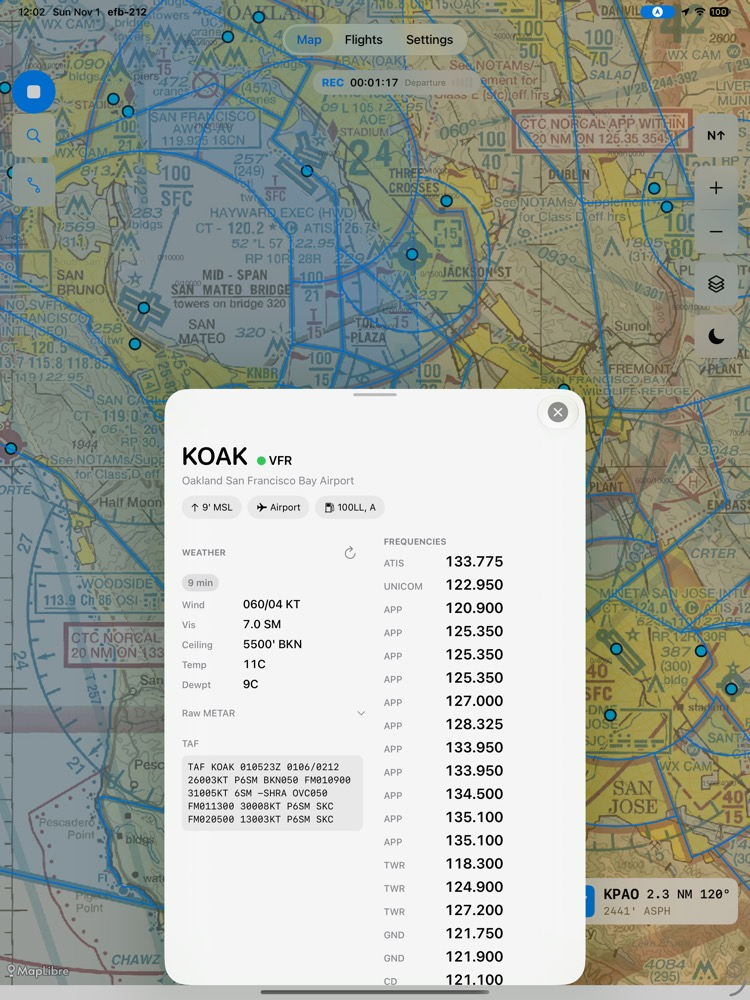<br>US: airport sheet with the METAR, its age badge, TAF and frequencies</td>
  </tr>
  <tr>
    <td align="center">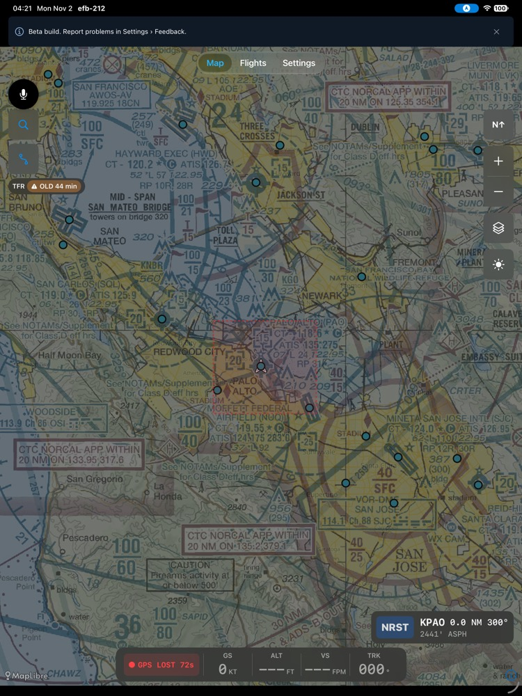<br>US: a stale TFR is faded, dashed and badged OLD; expired data is not drawn</td>
    <td align="center">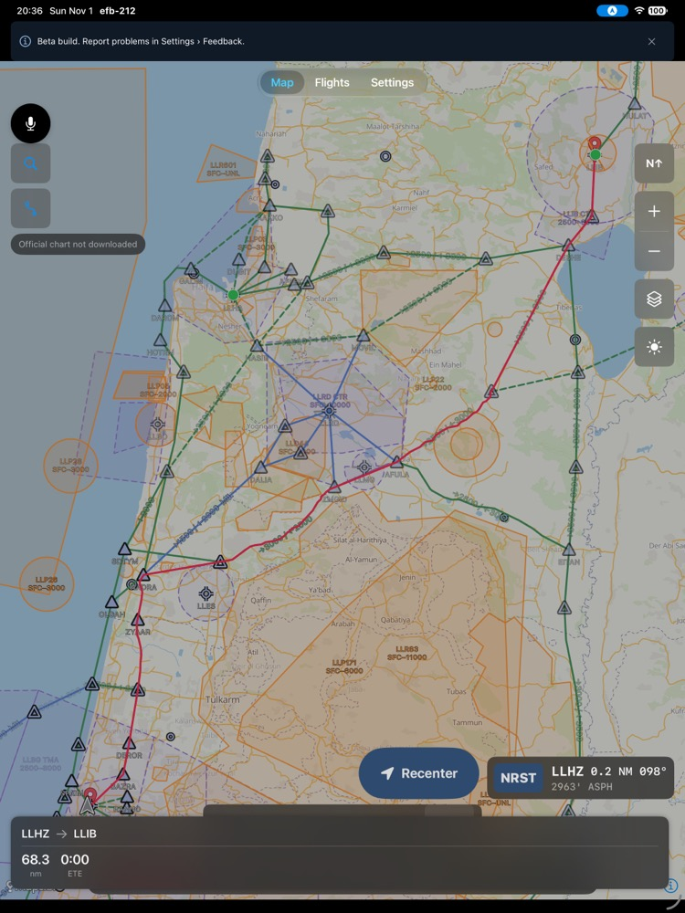<br>Israel: CVFR overlay with a planned LLHZ -> LLIB route</td>
  </tr>
  <tr>
    <td align="center">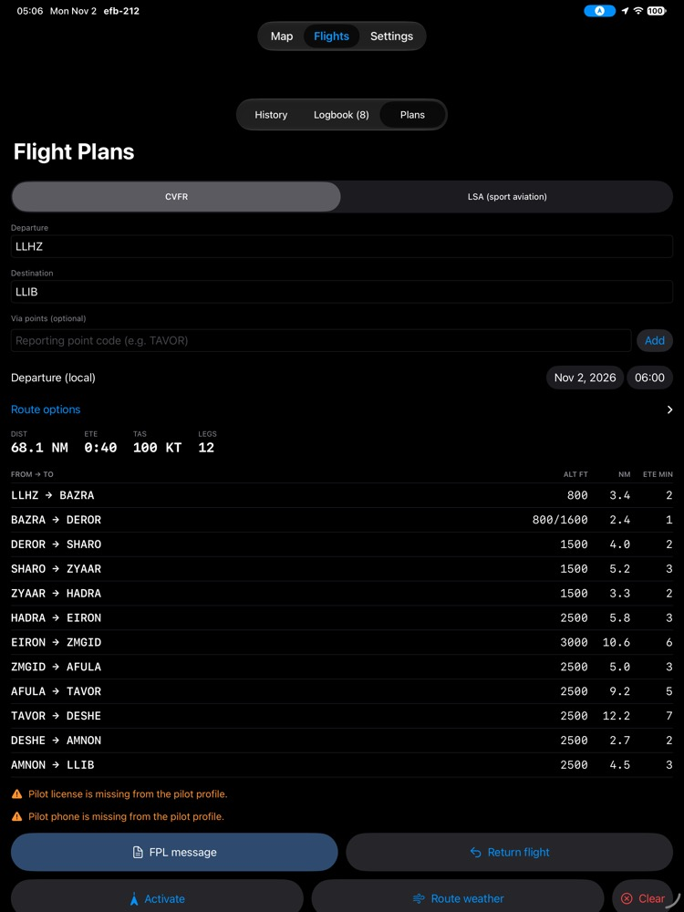<br>Israel: auto-routed CVFR plan with leg altitudes and times</td>
    <td align="center">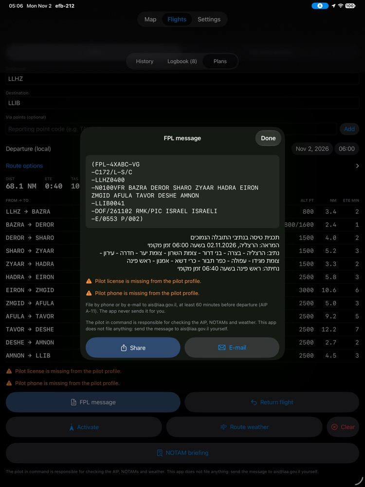<br>Israel: ICAO FPL message for the pilot to send to AIS (the app files nothing)</td>
  </tr>
  <tr>
    <td align="center">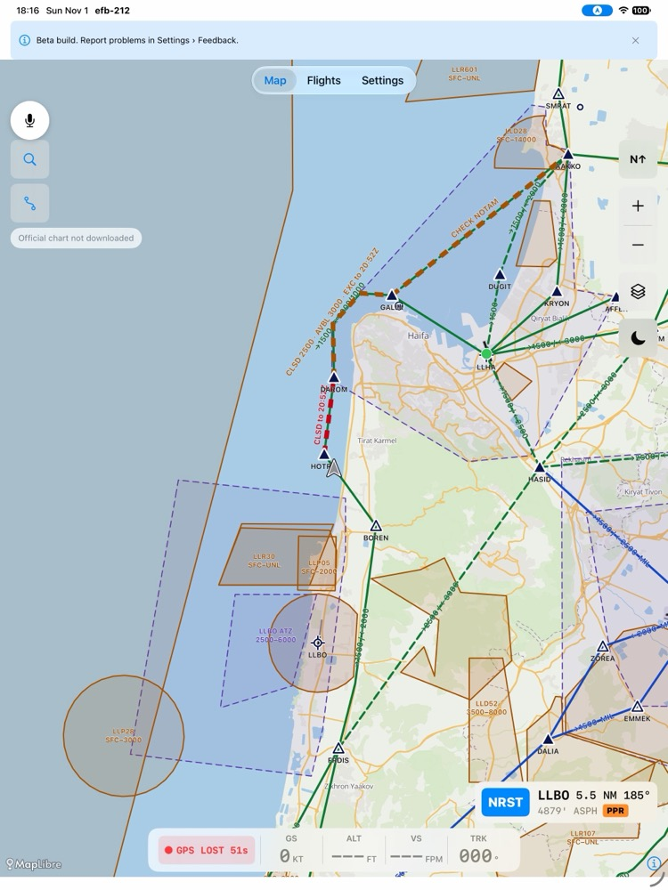<br>Israel: NOTAM route closures on the map (full, partial, check NOTAM)</td>
    <td align="center">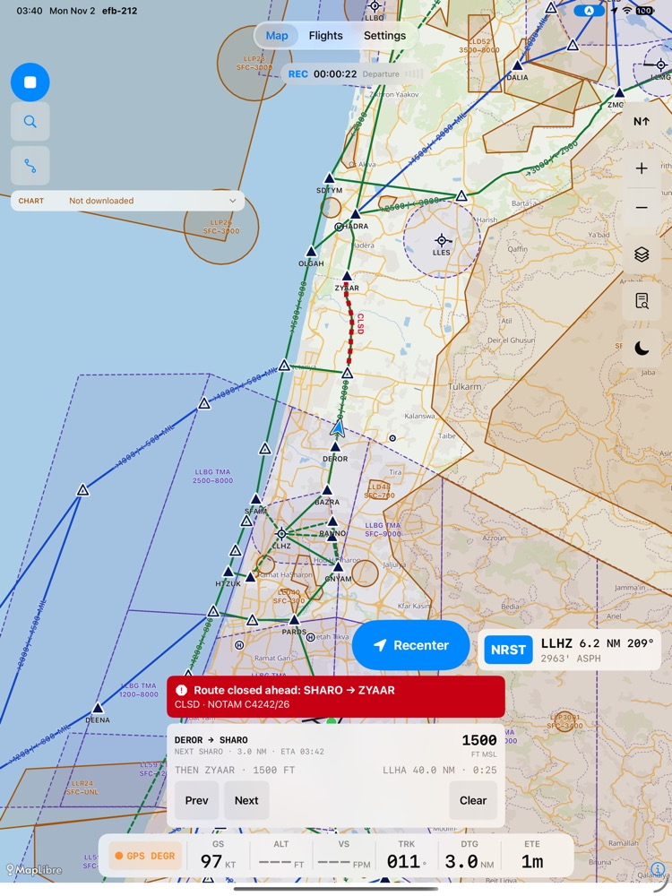<br>Israel: route bar in flight with a red closed-leg alert</td>
  </tr>
  <tr>
    <td align="center">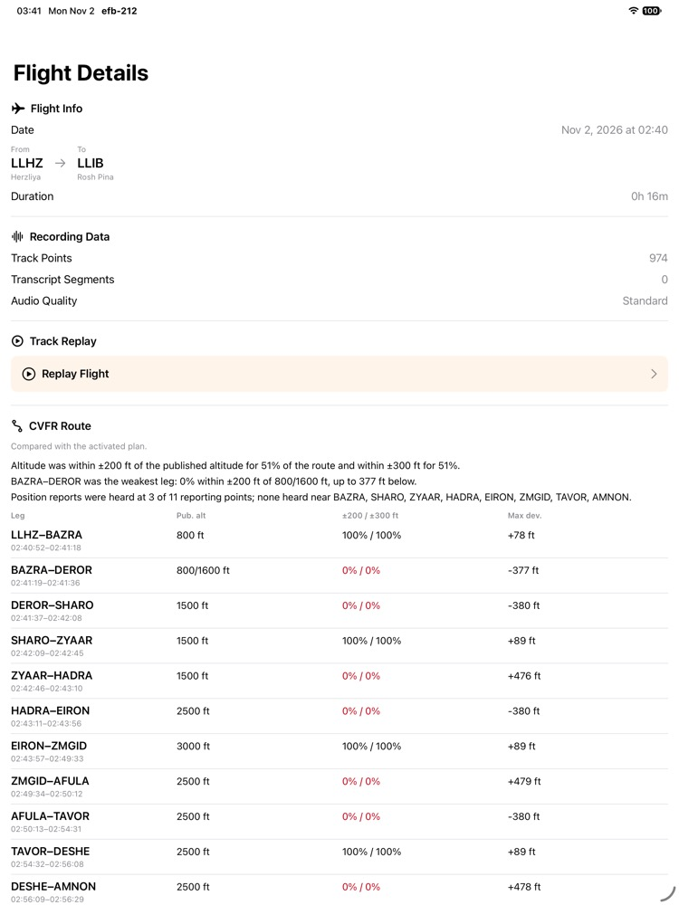<br>Israel: CVFR debrief, per-leg altitude adherence and position reports</td>
    <td align="center">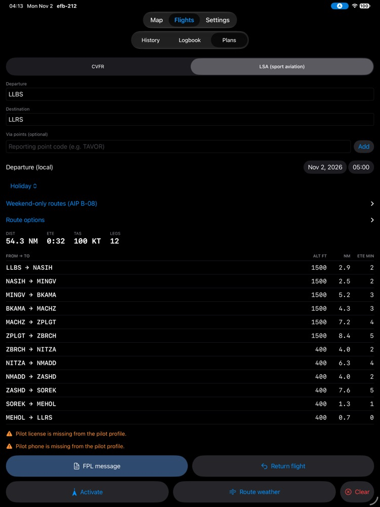<br>Israel: LSA (sport aviation) route with the weekend and holiday rule</td>
  </tr>
  <tr>
    <td align="center">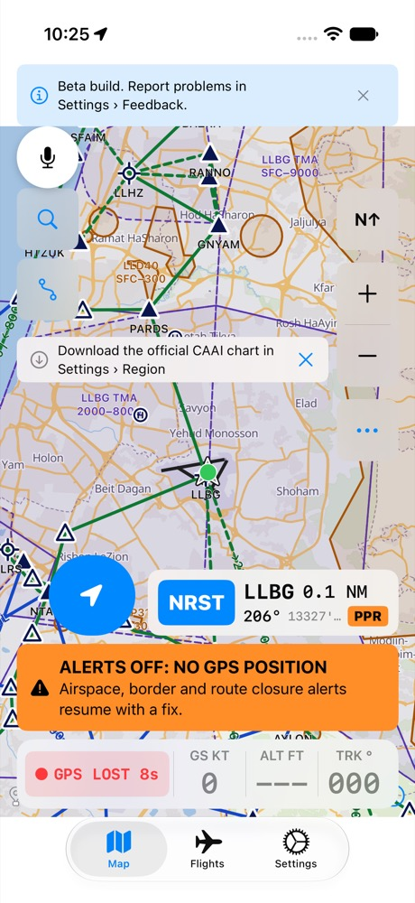<br>iPhone: compact map layout</td>
    <td align="center">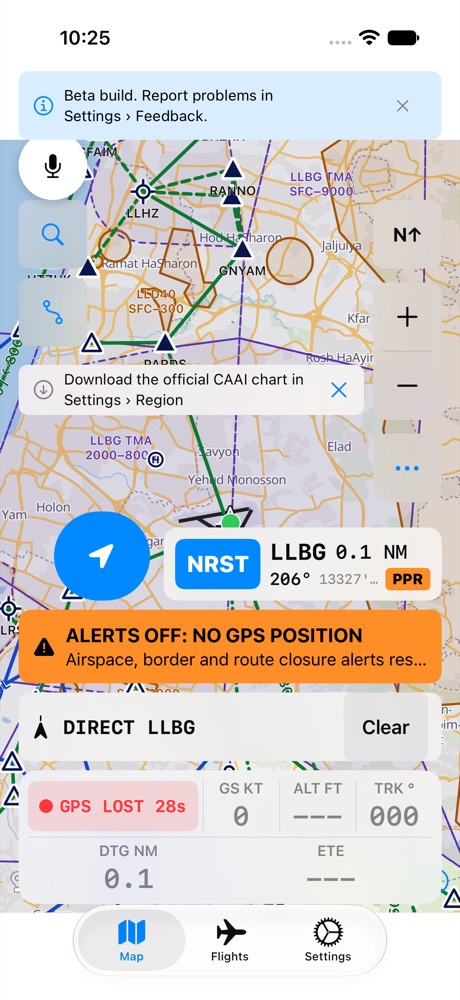<br>iPhone: Direct-To with distance and time to go</td>
  </tr>
  <tr>
    <td align="center">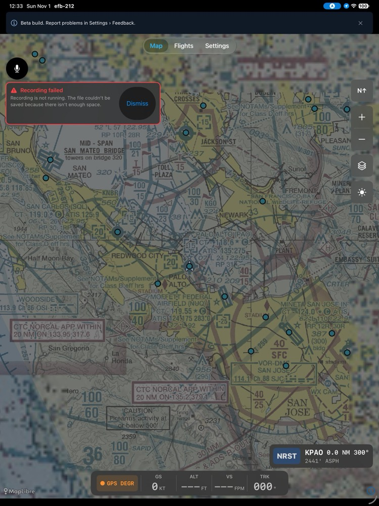<br>Recording: a failed recording is reported on the map, not hidden</td>
    <td align="center"><br>The Kanaf icon on the home screen</td>
  </tr>
</table>

## The Problem

ForeFlight costs $120-360/yr. The data it uses -- FAA airports, VFR sectional charts, NOAA weather -- is **free and public domain**, and Israel's CAAI publishes its CVFR data too. Android pilots have Avare (free, open-source). iOS pilots have had nothing free. Kanaf fills that gap.

## What Makes It Different

1. **Open-source and free** (MPL-2.0)
2. **Simplicity-first** -- VFR-focused, three tabs: Map, Flights, Settings
3. **Integrated flight recording** -- GPS track + cockpit audio + on-device radio transcription, built into the EFB
4. **On-device debrief** -- post-flight analysis written by Apple Foundation Models on supported devices; no audio, transcript or position is sent to any AI service

## Features

**Map and navigation**
- Moving map on the FAA VFR sectional (zoom 8-12), with Street, Satellite and Terrain base maps
- Airport database from FAA NASR (19,134 airports, runways, frequencies, navaids and Class B/C/D airspace), searchable, with spatial queries
- Ownship, track-up / north-up, instrument strip (ground speed, altitude, vertical speed, track), GPS status
- Nearest-airport readout and a nearest list with Direct-To; active navigation bar
- Day / night / auto display mode
- Offline map regions (sectional and Street)

**Airports and charts**
- Airport sheet: runways, frequencies, METAR and TAF, PIREPs, winds aloft
- NOTAMs, using the pilot's own free FAA API key (entered in Settings; Kanaf doesn't provide one)
- FAA terminal charts (approach procedures, airport diagram) downloaded as PDFs from FAA d-TPP
- Georeferenced airport diagram overlay on the map (advisory: verify against the FAA diagram)

**Weather and advisories**
- TFR and AIRMET/SIGMET layers, advisory only
- A data-age badge on every weather and advisory item; expired chart cycles are marked

**Planning and profiles**
- Departure-to-destination route with distance, time and fuel
- Aircraft and pilot profiles with currency tracking (under Settings > Profiles)

**Flight recording, replay and debrief**
- GPS track and cockpit audio, with on-device transcription (`SpeechAnalyzer`, `SFSpeechRecognizer` fallback)
- Auto-start above a ground-speed threshold (15 kt by default), flight-phase detection
- Replay with track, readouts, scrub bar and transcript
- Digital logbook with draft entries created from recordings (in the Flights tab)
- On-device debrief with Apple Foundation Models, where the device supports it

**Israel (Settings > Region)**
- CVFR routes, reporting points, CTR/ATZ/CTA/TMA and P/R/D areas from CAAI data, with altitudes per direction, drawn on the map; the official CAAI CVFR chart as a downloadable pack
- 49 curated aerodromes, airstrips and heliports, searchable in Hebrew and English, with runways, frequencies, circuit, hours and PPR
- CVFR and sport-aviation (LSA) route planning between aerodromes, with a legs table, the ICAO flight plan text for e-mailing to the IAA, and route following with the leg altitude, next reporting point and off-route cautions
- NOTAM briefing and route closures from the project's NOTAM relay, shown on the map and used by the planner
- CAAI aerodrome diagrams on the map where they pass the georeferencing gate, and as PDFs otherwise
- Weather (METAR/TAF, in hPa) for Israeli stations that publish it, proximity alerts for closed legs and P/R/CTR areas
- A CVFR debrief with per-leg altitude adherence and reporting-point passage, computed in code and shown without Apple Intelligence

## Limitations

- **TestFlight beta.** It has not been used in a cockpit by pilots yet, and hasn't been tried on a physical iPad in flight.
- **Not FAA-approved.** Kanaf has not been tested, approved, or certified by the FAA or any other aviation authority. It is a supplemental reference, not a primary means of navigation. iPad GPS isn't TSO-certified, and Wi-Fi-only iPads have no GPS.
- **Airport diagrams:** 820 of the 925 FAA airport diagrams (88.6%, cycle 2611) pass the automatic georeferencing checks and can be overlaid on the map. The rest are viewable only as the FAA PDF. Charts and diagrams are downloaded on demand, not bundled.
- **Satellite and Terrain are online only.** Offline downloads cover the sectional and Street maps. Satellite and Terrain tiles come from third-party hosts and are slated for removal before a public release.
- **Needs the internet:** weather, TFRs, AIRMET/SIGMET, PIREPs, winds aloft, NOTAMs, FAA charts and any map area you haven't downloaded. Works offline: the airport database, downloaded map regions and charts you have already opened.
- **Debrief** needs a device that supports Apple Foundation Models.
- **NOTAMs** need your own free FAA API key.
- iOS 26 or later; iPad is the primary device, iPhone is supported in portrait. No IFR procedures, ADS-B traffic, weight and balance, or cloud sync.

**Israel mode**

- **Unreviewed by Israeli pilots.** No Israeli CFI has reviewed the Israel mode yet (efb-aac.13). The 49 curated aerodromes are transcribed from the AIP and carry an amber "Unreviewed data" note on the airport sheet until the owner marks each field reviewed; confirm every value against the AIP.
- **The bundled CAAI data is a snapshot**: data of 25 Oct 2026, imported 2026-11-01, with no AIP amendment number recorded. The app shows the data date. The binding publications are CAAI's AIP and NOTAMs.
- **The official CVFR chart is a separate download** with its own validation gate: the app installs an edition only when it is published and passed the gate (cross-validated p95 of at most 200 m against CAAI's own reporting points; the 2025-02 chart measured 187 m, which is the chart's own drafting error). The chart is © CAAI and the base map © Mapa Ltd; CAAI approved in-app use of the chart, and the base map is used under that approval for in-app display. Neither is covered by this project's license. Without the download, the app draws the CVFR routes, points and airspace from the vectors.
- **Aerodrome diagrams are placed at ±100 ft**, twice the 50 ft US gate, and only when the chart passes the runway and ARP checks: 5 of 13 Israeli charts are placed (LLBG, LLHA, LLIB, LLBS, LLEY); the rest open as sheet-only PDFs. The badge shows the edition and "±100 ft". Verify against the printed chart. Diagram artwork is © CAAI; CAAI approved its in-app use.
- **NOTAM route closures** come from the project's relay, which scrapes the IAA site, and are parsed by rules. A closure the parser can't read in full shows as "possible closure, read NOTAM"; a closure the planner can't place on the network blocks filing ("Unresolved closure: check NOTAM"). The relay refreshes every 15 minutes, the app judges the feed's age from the relay's own scrape time and not from the download time, and it serves the last saved copy when a refresh fails. If the IAA blocks the relay, the feed stops updating.
- **Filing:** the app builds the FPL text; you send it to ais@iaa.gov.il yourself. The app sends nothing.
- **Sport-aviation (LSA) weekend rules** follow the AIP text; the layer has no holiday calendar, so you declare holiday eves in the plan.
- **Open review findings:** ten severity 1-2 findings from the Israel usability review are filed as efb-aac.21 to efb-aac.30.

## Tech Stack

| Component | Technology |
|-----------|-----------|
| Platform | iPad and iPhone, iOS 26.0 |
| Language | Swift 6.0 language mode, SwiftUI |
| Architecture | MVVM with the Observation framework (`@Observable`); one root `AppState` |
| Map Engine | MapLibre Native iOS (open-source, no API fees) |
| Aviation Data | FAA NASR, imported offline by `tools/nasr-importer` into a bundled SQLite database; CAAI GIS layers and curated aerodromes, imported by `tools/caai-importer` into `israel-aviation.sqlite` |
| Database | GRDB (aviation data with R-tree and FTS indexes; recording data) + SwiftData (profiles, flights, plans, logbook, settings) |
| Weather | NOAA Aviation Weather API (free, no key) |
| Charts | FAA VFR sectional raster tiles (ArcGIS); FAA d-TPP terminal chart PDFs; Israel: the CVFR overlay drawn from CAAI vectors, plus the official CVFR chart and aerodrome diagrams as downloaded packs from Cloudflare R2 |
| Recording | In-app: `Services/Recording/` (GPS, audio, `SpeechAnalyzer` transcription) |
| Debrief | Apple Foundation Models (on-device) |

Swift packages: MapLibre Native iOS and GRDB.swift. Nothing else.

## Build and Run

Requires Xcode with the iOS 26 SDK.

```bash
git clone https://github.com/omercnet/openefb.git
cd openefb
open efb-212.xcodeproj    # SwiftPM resolves MapLibre and GRDB on first open

# Select an iPad simulator or device -> Cmd+R
# Run tests: Cmd+U
```

From a shell, use `tools/sim-test.sh` (it owns the simulator and derived-data handling):

```bash
export DEVELOPER_DIR=/Applications/Xcode.app/Contents/Developer
tools/sim-test.sh build -quiet                        # compile app + tests
tools/sim-test.sh test -only-testing:efb-212Tests     # unit tests (1065 tests, 0 failed as of 2026-11-02)
tools/sim-test.sh demo                                # install and launch at KPAO on the simulator
tools/fly.sh                                          # feed a simulated VFR route (KPAO -> KSQL -> KOAK -> KSFO)
```

The server-side pieces under `web/` build separately (`cd web/notam-relay && npm ci && npm test`, and the same in `web/charts`); see `web/README.md`.

## Project Structure

```
openefb/
├── efb-212/
│   ├── efb_212App.swift       # App entry point
│   ├── ContentView.swift      # 3-tab root: Map / Flights / Settings
│   ├── Views/
│   │   ├── Map/               # Moving map, controls, instrument strip, airport sheet, layers
│   │   ├── Planning/          # Flight plan creation
│   │   ├── Flights/           # History, detail, replay, transcript, debrief
│   │   ├── Logbook/           # Logbook (shown in the Flights tab)
│   │   ├── Aircraft/          # Aircraft + pilot profiles (Settings > Profiles)
│   │   ├── Settings/          # Settings, offline maps
│   │   ├── Onboarding/        # First-run onboarding
│   │   └── Components/        # Badges, dots, search, banners
│   ├── ViewModels/            # @Observable @MainActor view models
│   ├── Services/              # Weather, TFR, NOTAM, charts, map, offline maps, currency
│   │   ├── Recording/         # Track, audio, transcription, auto-start, persistence
│   │   ├── Replay/            # Replay engine
│   │   └── Debrief/           # On-device debrief
│   ├── Data/                  # AviationDatabase, IsraelAviationDatabase, RecordingDatabase (GRDB), Models/ (SwiftData)
│   ├── Core/                  # AppState, types, errors, design tokens
│   └── Resources/             # Bundled aviation.sqlite, map style
├── efb-212Tests/              # Unit and integration tests (Swift Testing)
├── efb-212UITests/            # Xcode template stubs
├── tools/                     # sim-test.sh, fly.sh, nasr-importer/, apd-georef/, caai-importer/, caai-chart/, caai-apd/
├── web/                       # Server side, not in the app: notam-relay/ (Cloudflare Worker), charts/ (R2 publish), interviews/ (Vercel)
├── dist-prep/                 # TestFlight / App Store prep
└── docs/                      # Design, product, handoff briefs
```

## Data Sources

All free to use. The FAA and NOAA data is public domain. CAAI approved redistribution of its GIS layers and in-app use of the official CVFR chart and aerodrome diagrams (see `NOTICE`); that artwork stays © CAAI (base map © Mapa Ltd) and is outside this project's license. Map tiles have their own terms:

| Source | Data | Update Cycle |
|--------|------|-------------|
| [FAA NASR](https://nfdc.faa.gov) | Airports, runways, frequencies, navaids (bundled database) | 28 days |
| FAA AIS Class Airspace | Class B/C/D airspace (bundled database) | with NASR |
| FAA VFR sectional tiles (ArcGIS) | Sectional raster tiles | 56 days |
| [FAA d-TPP](https://aeronav.faa.gov) | Terminal charts and airport diagrams (PDF) | 28 days |
| [NOAA Aviation Weather](https://aviationweather.gov/data/api/) | METARs, TAFs, PIREPs, AIRMET/SIGMET, winds aloft (also used for Israeli stations) | Real-time |
| [FAA TFR](https://tfr.faa.gov) | Temporary flight restrictions | Real-time |
| FAA NOTAM API | NOTAMs (your own free API key) | Real-time |
| Civil Aviation Authority of Israel (CAAI) | GIS layers published with the Israeli domestic AIP: CVFR and sport-aviation (LSA) points and routes, CTR/ATZ/CTA, TMA, FIR, prohibited/restricted/danger areas, runways (bundled database, data of 25 Oct 2026); curated aerodrome data from the domestic AIP and eAIP; aerodrome diagrams and the CVFR chart (downloaded packs) | Per AIP amendment; the bundled database is a snapshot |
| Israel Airports Authority (IAA) | NOTAMs, scraped by the project's relay every 15 minutes; the app reads the relay's `notams.json` and never contacts the IAA | 15 minutes |
| OpenFreeMap / OpenStreetMap, Esri, OpenTopoMap | Street, Satellite and Terrain base maps | n/a |
| Cloudflare R2 and Workers | Host the project's Israel chart and diagram packs and the NOTAM relay | n/a |

## Roadmap

| Phase | Focus | Status |
|-------|-------|--------|
| **Phase 1** | Core VFR EFB (map, airports, weather, planning) | Complete |
| **Phase 2** | Flight recording, replay, logbook and on-device debrief | Built; in TestFlight beta |
| **Phase 3** | IFR procedures, ADS-B traffic, advanced features | Planned |

Open work is tracked on the Paseo Progress dashboard (`paseo-progress show`).

## Contributing

This project is in early development. Open an issue or start a discussion.

1. Fork the repository
2. Create a feature branch
3. Make your changes and run tests (`Cmd+U`)
4. Open a pull request

## License

[MPL-2.0](LICENSE) -- file-level copyleft. Kanaf is a modified version of OpenEFB by Ryan Stern, MPL-2.0; see `NOTICE`. New documentation: © 2026 Omer Cohen and contributors.

## Thanks

Kanaf began as a fork of **OpenEFB** by **Ryan Stern** ([sternryan/openefb](https://github.com/sternryan/openefb)). His product requirements, architecture and the first working app are the foundation this project grew from, and his decision to make it open-source under MPL-2.0 is the reason it exists. Thank you, Ryan. Thanks also to CAAI for approving use of its data and charts, and to the FAA, NOAA, OpenStreetMap and OpenFreeMap communities.

## Disclaimer

Kanaf is a supplemental reference tool. It is **not** intended as a primary means of navigation. Pilots are responsible for maintaining situational awareness through all available means including current paper charts, ATC communication, and visual references. This software has not been tested, approved, or certified by the FAA or any other aviation authority.
