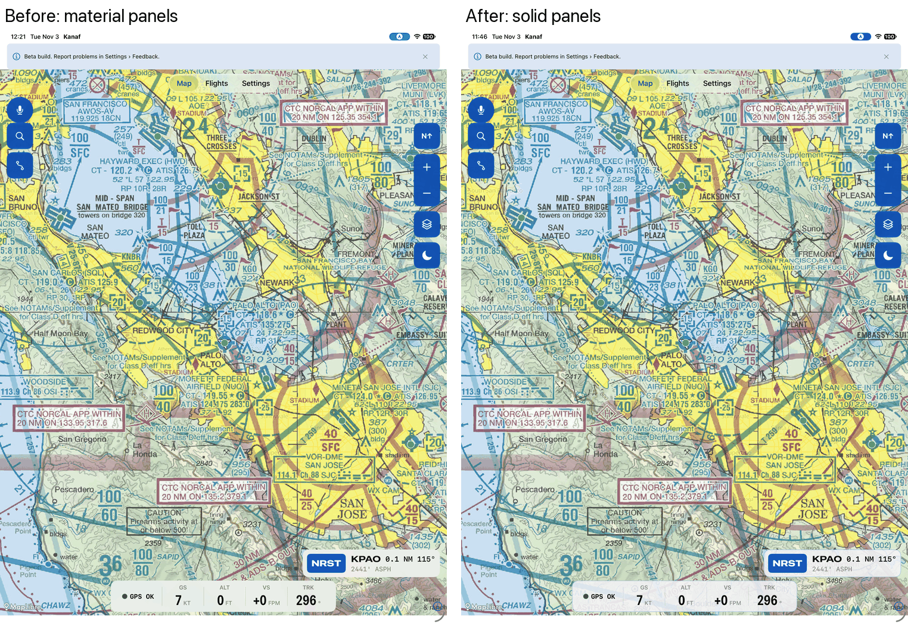
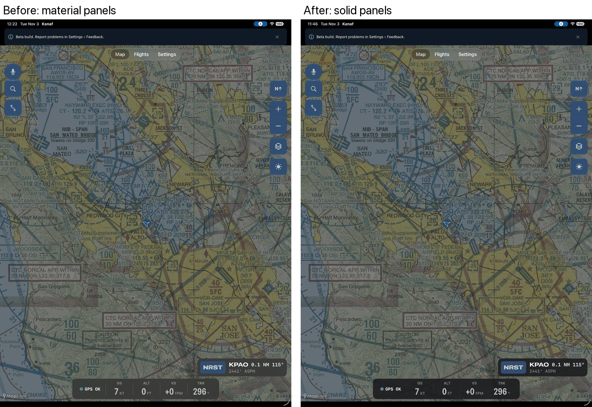
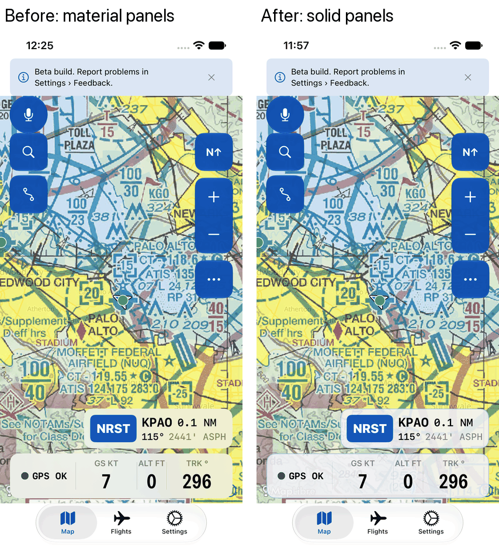
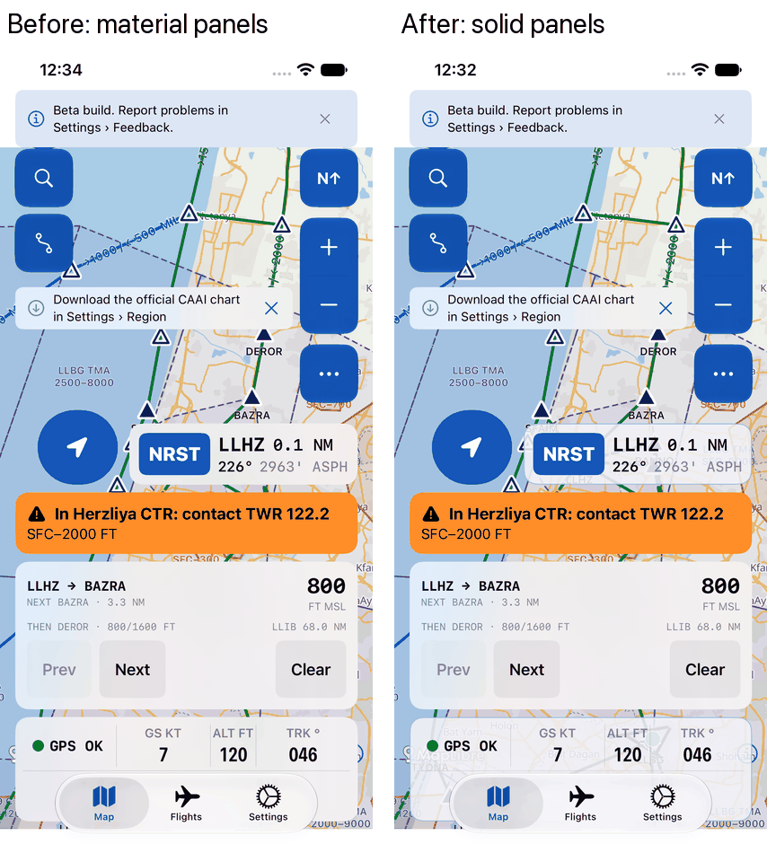
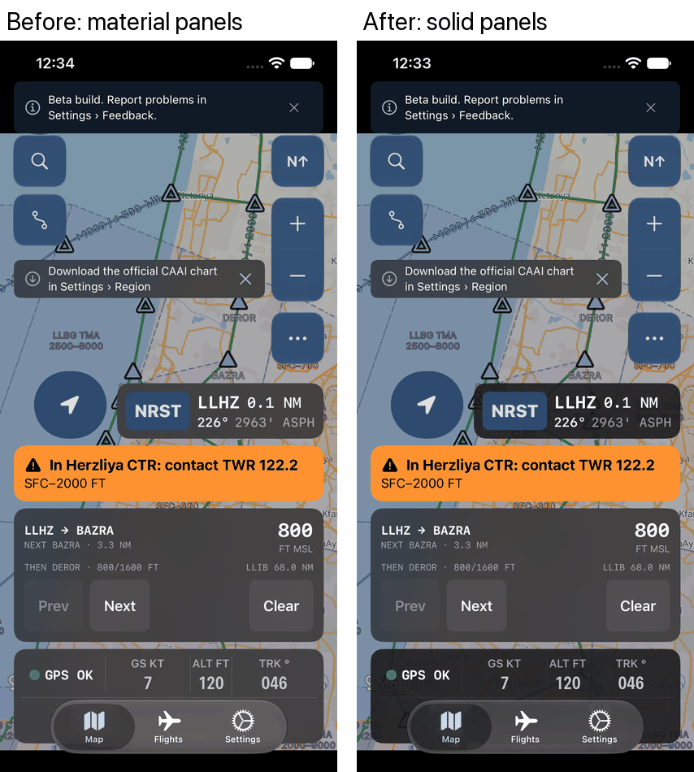
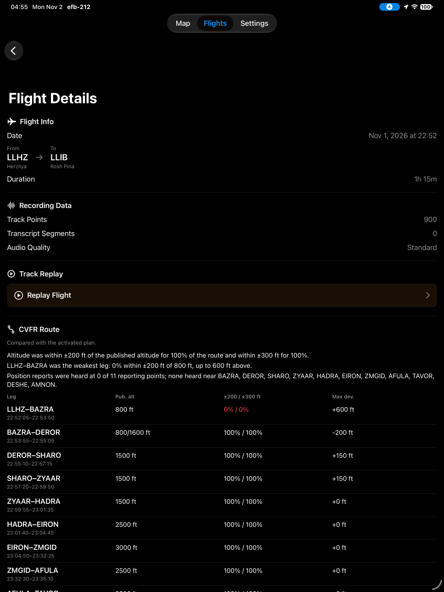
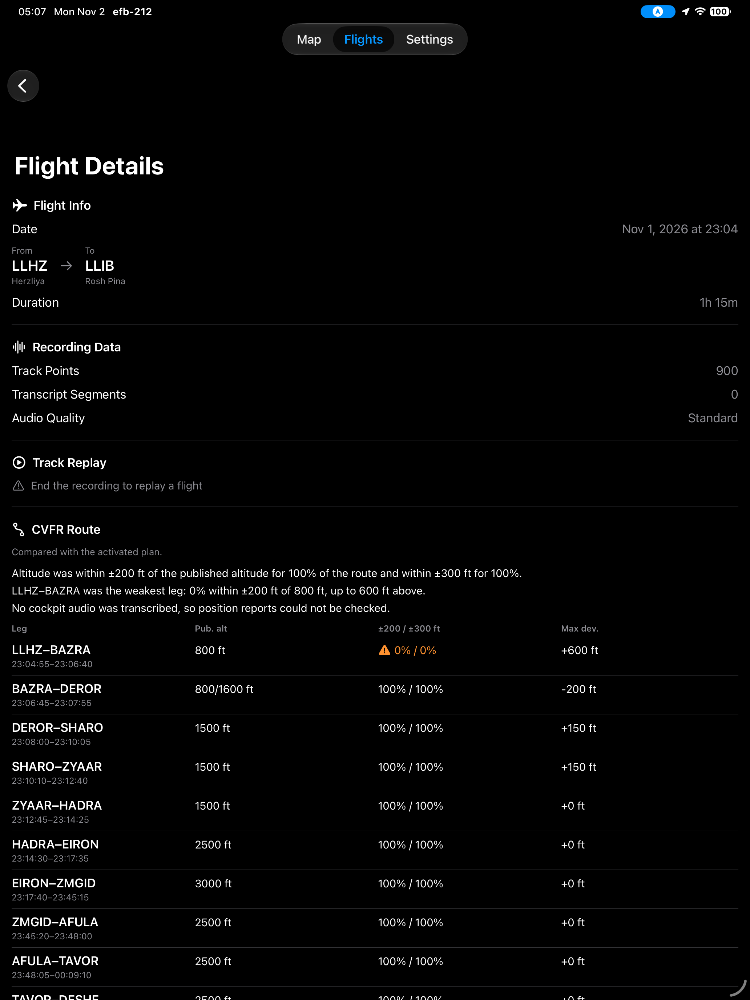
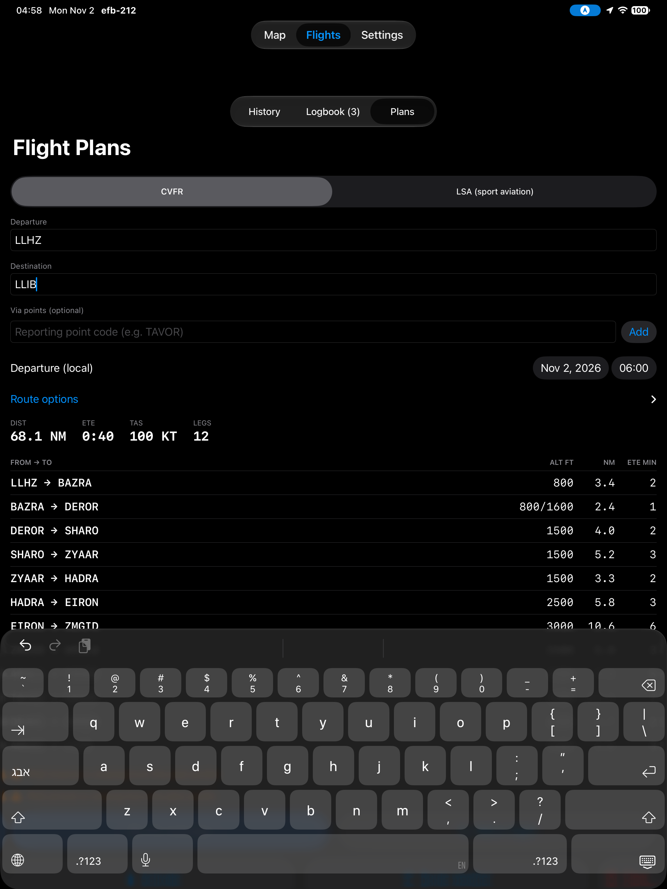
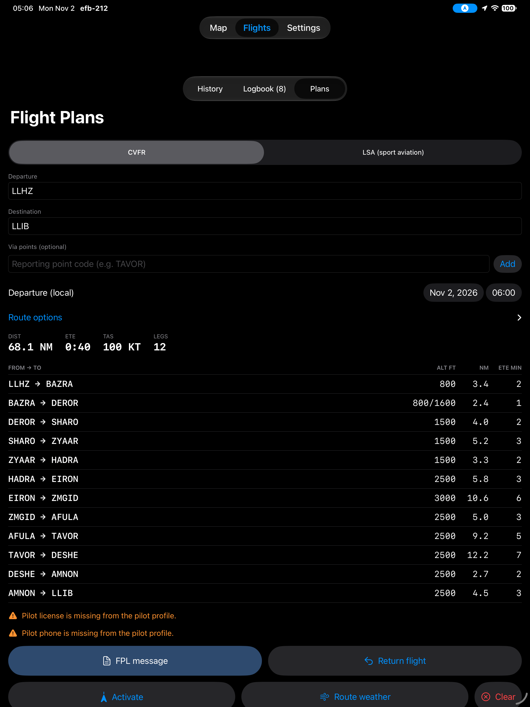

# Design System

## Design Direction
A cockpit instrument first, an app second. Anchor job: J1 in-flight awareness (docs/CUSTOMER.md).
The worst gap is trust, so every screen must answer "is what I see true right now?" before anything else.

Rules (the EFB lens):
- Glanceable in sunlight.
- In-flight controls ≥ 60pt, larger than the 44pt minimum (turbulence).
- Night palette that preserves dark adaptation.
- **Red = warning, amber = caution**, nothing else.
- Standard aviation abbreviations stay.
- Stale or unvalidated data is never shown as current.
- No decorative animation in flight.

## Direction 2: the log and the leading edge (2026-11-05; stage 1 built 2026-11-06)

The owner rejected four re-skins of today's layout (`docs/design/mocks/directions.html`) and asked for a reinvention. Fable and Opus each proposed one independently (`docs/design/mocks/fable.html`, `docs/design/mocks/opus.html`); the owner chose a merge of the two (Paseo Progress Q2 C). Merged mock: `docs/design/mocks/merge.html`. Stage 1 is in the app (pull request #13); where the older sections below describe the floating controls, instrument strip, NRST box or tab bar, this section wins.

Stage 1 as built: the strip is layout beside the chart, not an overlay, so the map needs no camera padding; the app opens on the map (the in-flight screen) and the strip's LOG button opens the log stack; the CVFR debrief keeps its current screen until stage 2.

**The idea.** A VFR flight is a nav log, and the pilot's question is what comes next. Kanaf shows one object, the log, in three tenses: Next (planned), Now (flying), Flown (debrief and logbook). In flight the log reads forward: the next thing ahead gets the biggest type on the screen.

From Fable (the skeleton):
- The log is a strip pinned to the chart's edge (left; right edge in Hebrew). Waypoints are rows, legs are the space between them, the active leg's cell holds the live readouts.
- The home screen is the log stack: planned flights, today's flight, past flights with per-leg grades, totals footer. The stack is also the logbook.
- An airport opens in the strip's column; the chart stays live beside it. A debrief is the flight's own strip with the actuals written in.
- The wing (כנף) is both the ownship glyph and the marker on the active leg's gauge.

From Opus (the reading order):
- Future is loud: time-to-next is the largest number. Present numbers (GS, TRK, ALT with VS) sit in the active cell at readout size, below it.
- The chart is ruled in minutes along the track; the strip's row times and the map's minute ticks are the same times.
- Predicted events (airspace floors, boundaries) are rows in the log, in time order, each stating its assumption ("at 312°, +300 fpm"). Stale input turns predictions off; it never shows them as current.
- Night has no filled amber blocks: amber rule and amber type on near-black.
- The debrief unrolls the line: strip map, profile against the ±200 ft band, and radio (heard / not heard) on one axis, with no overall score that hides a bad leg.

Thrown away: the tab bar, floating round map buttons, the bottom instrument strip, the NRST box, the layer panel, bottom sheets, list-and-detail flight screens. Layers, night, zoom, NRST and GPS state become 60pt cells in the strip's footer, GPS state first. Direct-to is inserting a row.

Type: one OFL system bundled with the app. Archivo (variable; condensed widths for readouts and idents, normal width for labels), IBM Plex Mono for times and log data, IBM Plex Sans Hebrew. Day chrome is cool paper; magenta = route, chart blue = airspace, red = warning, amber = caution, ink for everything else.

The EFB rules above all still hold.

### Stages
| Stage | Ships | Needs |
|---|---|---|
| 1. The log | Strip and footer replace `InstrumentStripView`, `MapControlsView`, `NearestAirportHUD`, `LayerControlsView`, `ActiveNavigationBar` and `IsraelRouteFollowingBar`; the log stack replaces the three-tab `ContentView` and `FlightHistoryListView` / `LogbookListView`; airport in the strip column replaces `AirportInfoSheet`; minute ticks on the track line (`MapService` line layer, camera padding for the strip); new type and palette tokens in `Core/DesignTokens.swift` with fonts in `UIAppFonts`; night palette; iPhone rail; Hebrew mirroring. Next thing = next waypoint and its ETE. | Builds and simulator runs on a Mac (`tools/sim-test.sh`); Dynamic Type check of the strip at AX sizes; VoiceOver order of the log |
| 2. The leading edge | Prediction rows (airspace floor and boundary times from track, GS and VS), the amber next-thing block, the compact altitude tape in the active cell; debrief unrolled bands | A prediction service with tests for noisy GPS, rules for suppressing jumpy or stale predictions, and an owner or CFI review before pilots see it |

Riskiest assumptions: a strip that permanently takes a third of an iPad's width beats an edge-to-edge chart (Fable), and predictions from GPS in bumpy air stay steady enough to trust (Opus). Both need a pilot in a real cockpit before stage 2.

### Decisions from the merged mock
- **Only the next thing is loud.** The top row of the strip carries the one large time (about 100pt on iPad); later rows, waypoints or events, use about 44pt.
- **NRST opens the nearest list in the strip column; one tap on a row inserts the direct-to.** A one-tap insert of the nearest field could pick a heliport or a short strip (finding F1); two taps keeps the choice (F2).
- **Footer: GPS state, NRST, layer, zoom in, zoom out.** Night moves into the layer cell's menu, so the footer is one row on iPad and fits the iPhone with NRST showing distance and bearing. After a pan, the zoom-in cell becomes Recenter until the chart follows ownship again (F3), so nothing floats over the chart.
- **The debrief runs on distance.** The strip map, profile and radio bands share one distance axis; times are labels at the waypoints. Short legs may be drawn at a marked half scale.
- **The strip is a fixed 400pt in flight on iPad** (owner, Paseo Progress Q3 A): no collapsed mode. That is 34% of an 11" iPad and 29% of a 13" in landscape; test it with a pilot in a cockpit before stage 2.

## Typography
SF Pro system text styles (Dynamic Type); numeric readouts monospaced. Roles live in `Core/DesignTokens.swift` (`TypeRole`):

| Role | Style | Use |
|---|---|---|
| title | largeTitle rounded semibold | Airport identifier |
| sectionHeader | caption bold, uppercase text | FREQUENCIES, RUNWAYS, BASE MAP |
| label | footnote medium, secondary color | "Wind", "TWR": labels are quiet |
| value | title3 monospaced-digit semibold | Frequencies, runway idents |
| valueSmall | callout monospaced-digit medium | Decoded weather, runway size |
| body / caption | subheadline / footnote | Prose, validity lines |

Rule: value louder than label. Never `.tertiary` for text (below 4.5:1 on the material).

## Tokens
Defined in `efb-212/Core/DesignTokens.swift`.

| Token | Value | Use |
|---|---|---|
| `Space.xs/s/m/l/xl/xxl` | 4 / 8 / 12 / 16 / 24 / 32 pt | Between groups > within groups |
| `Palette.primaryText` / `secondaryText` | `.primary` / `.secondary` | All text |
| `Palette.caution` | `.orange` (amber) | Old data, expired cycle |
| `Palette.warning` | `.red` | Closures, urgent PIREPs, lost GPS |
| `Palette.fill` | secondary at 12% | Chips, quiet rows |
| `Palette.ok` | #147832 day / systemGreen night | "Fine" only: confirmed entry, GPS fix, VFR dot |
| `Palette.cautionFill` | `.orange` | Solid amber chips and banners, always with black text (9:1) |
| `Palette.accent` / `accentText` / `infoFill` | Kanaf navy, see Night palette | Buttons, links, notices; `accentText` is also the app tint (`AccentColor` asset) |
| `Radius.xs/s/m/l` | 4 / 8 / 10 / 14 pt | Tags / rows and banners / controls and cards / panels. No literal radii in views |
| `TypeRole.title`, `identifier`, `sectionHeader`, `label`, `body`, `caption` | Bundled Archivo (Condensed SemiBold for names, Medium / SemiBold for labels, Regular for prose), Dynamic Type through `UIFontMetrics`, Hebrew falls back to IBM Plex Sans Hebrew | Names, headings, labels, prose |
| `TypeRole.value`, `valueSmall`, `data`, `dataEmphasis` | IBM Plex Mono | Frequencies, times, distances, log data |
| `TypeRole.readout(size:)`, `nextTime`, `rowTime`, `rowIdent` | Archivo ExtraCondensed with tabular digits (`nextTime` ~100pt capped at 120, `rowTime` 44pt capped at 64) | Readouts in the NOW cell; the next thing's time-to; later rows |
| `Palette.paper` / `paperSecondary` / `activeCell` / `rule` / `ink` / `inkSecondary` | Day #EEF0F2 / #E2E5E9 / #FFFFFF / #C3C8CE / #14191F / #4A535E; night #0D1013 / #232930 / #161A1F / #2A3037 / #C9C4BA / #8E9298 | The strip, its columns and the log stack |
| `Palette.route` / `airspace` | Day #C2168D / #1B58A3; night #93407A / #86A3CB | Route glyphs and airport data blocks in the strip |
| `StripMetrics` | width 400, rail 104, cell 60 | The strip (owner decision Q3 A), the iPhone rail, every in-flight tap target |
| `MapColor.trackRuler*` | Ink day #14191F, night #B6B0A3 | The minute-ruled track line, ticks and labels |
| `Palette.northMarker` | Day #FF9F94, night #FF8F86 | North arrow on the navy compass glass, >= 3:1 (see Kanaf look) |
| `Palette.categoryMVFR` / `categoryLIFR` | systemBlue / #CC00CC day; #8FB5E0 / #E673E6 night | Flight-category dots (VFR `ok`, IFR `warning`) |
| `MapColor.*` | The system colours the map layers already used | Ownship, airspace, weather dots, TFRs, replay track, NOTAM map highlight. Named only; recolouring ownship or airspace is a separate decision to make over the sectional |

All are SwiftUI semantic colors, so the night-mode ticket can retheme in one place. Red = warning (the compass north marker, `Palette.northMarker`, is the one convention exception), amber = caution, magenta = route.

## Kanaf look (PR #5)

PR #5 (2026-11-02) gave the app its own look inside the HIG; the follow-ups (2026-11-03) finished it:

- **Accent:** Kanaf navy (`Palette.accent`, `AccentColor` asset), #1556B8 by day (#0C4091 with Increase Contrast), #2E4A6E fill and #8FB4E0 text at night. Day systemBlue failed 4.5:1.
- **Floating map controls:** `mapControlSurface()`, Liquid Glass tinted navy with white (night grey 85%) glyphs, 60pt. Measured over the official CAAI CVFR chart on the iPad simulator: glyphs 7.3:1 by day, 6.1:1 at night, so no change was needed. Screenshots (CAAI artwork) are kept out of git in `docs/design/screenshots/UX-IL-CAAI/`.
- **Panels:** the instrument strip and NRST box moved from `.regularMaterial` to `panelSurface()`: a light solid panel with a navy hairline by day, the old dark panel at night. Material took on the sectional's yellow; the solid panel stays neutral grey. The panel is slightly see-through, so the GPS status chip (GPS LOST / STALE) sits on an opaque `Palette.statusChipBase` with an 8% tint: its amber or red text keeps >= 4.6:1 over any map.
- **Type:** expanded SF Pro for names and headings (`TypeRole.title`, `identifier`, `sectionHeader`); condensed SF Pro with fixed-width digits for the 32pt readouts.
- **North marker:** the red arrow on the compass glass was 2.1:1 by day and 2.5:1 at night (needs 3:1 as a graphical object). It is now a light red, measured on screen: 3.7:1 day, 3.9:1 night, 5.2:1 day / 4.1:1 night with Increase Contrast, 3.5:1 / 4.2:1 with Reduce Transparency. The arrow was also invisible: inside the controls' `GlassEffectContainer` it was a sibling over a separate glass view and was drawn under the glass; it is now the glass view's own content.
- **Increase Contrast / Reduce Transparency** (simulator): the high-contrast navy applies to the map controls; the strip, NRST box and route bar stay legible with both settings, day and night. Still to do on a real iPad: VoiceOver and Reduce Transparency, which the simulator only approximates.

Before (material panels) and after (solid panels), same position and time:

| Where | Before (left) and after (right) |
|---|---|
| iPad, KPAO sectional, day |  |
| iPad, KPAO sectional, night |  |
| iPhone 17e, KPAO sectional, day |  |
| iPhone 17e, Israel street map, day |  |
| iPhone 17e, Israel street map, night |  |

## Components
| Component | Decision | Status |
|---|---|---|
| SectionHeader | One uppercase section heading, used by the airport sheet and layer panel | done |
| Frequency row | 72pt label column, abbreviations (CTAF, UNICOM, ATIS, AWOS, ASOS, TWR, GND, CD, APP, DEP, CTR, FSS), value large | done |
| DataAgeBadge | One freshness badge for every dated product: neutral fresh, amber OLD/EXPIRED with a triangle glyph, red only when unsafe; thresholds in `## Freshness thresholds` | done |
| Layer panel | BASE MAP picker, SECTIONAL toggle + opacity, DATA LAYERS toggles, 300pt wide | done |
| Map symbols | Ownship: dark halo, fill, white edge. Airports/navaids: dark ring | done |
| Transcription panel | Sits in the map's bottom stack above the instrument strip, never over it | done |

## UX Audit Findings

Phase 2 (ux-heuristics) and Phase 3 (design-everyday-things) audit, 2026-10-31. Flows walked in the
simulator (iPad Pro 13", iOS 27.0, position KPAO): map → nearest list → search → airport sheet →
charts; track-up toggle; pan away; zoom out; record; layer panel. Screenshots are in
`docs/design/screenshots/audit/`. Severity 0-4 (4 = catastrophic). Heuristic numbers are Nielsen's
(H1 visibility of status … H10); Norman gulfs are E (execution) and V (evaluation).

| # | Issue | Heuristic | Severity | Fix | Status |
|---|---|---|---|---|---|
| F1 | **Nearest Airports lists heliports first.** From KPAO, #2 and #3 are hospital heliports ("Stanford Health Care East Heliport", "US-2776"); in LA the HUD showed "CL71 Hughes/Corporate Heliport". In an emergency the pilot is pointed at a helipad. (`05-nearest-list.png`) | H5 error prevention; V | 4 | Nearest = landable for a fixed-wing aircraft: exclude heliports and seaplane bases; require a runway (min length from the aircraft profile, default 1,500 ft). Show longest runway length and surface on each row. Flag private fields. | open (efb-77r.9) |
| F2 | **The emergency entry point is an 11pt capsule** in the bottom-right corner (~20pt tall), with no "Nearest" label. Hard to find and hit under stress. | H6 recognition; E | 4 | Persistent **NRST** button, ≥60pt, fixed position; the top entry shows ident, distance, bearing and runway. One tap opens the list; one tap on a row starts Direct-To. | open (efb-77r.9) |
| F3 | **The map doesn't follow the aircraft** and there's no recenter control. After a pan, ownship stays off-screen indefinitely. (`03-map-after-pan.png`) | H1 status; H3 control; V | 3 | Follow-ownship mode, on by default. Panning suspends it and shows a large "Recenter" button; recenter re-engages. Show the mode on screen. | open (efb-77r.10) |
| F4 | **Track-up shows a second ownship.** It switches MapLibre's user-tracking mode, which draws the system blue location puck instead of our chevron, and the puck stays after switching back. Two ownship symbols is a mode error. (`02-map-trackup.png`) | H4 consistency; V | 3 | Implement track-up by rotating the camera to GPS track and keep our chevron. Never enable the system user-location puck. North indicator visible when rotated. | open (efb-77r.10) |
| F5 | **No GPS / position-quality status.** When the fix is lost or degraded (Wi-Fi iPad, no altitude), the only signal is dashes and a small "No GPS" that overlaps the TRK label. Ownship doesn't show it's stale. | H1 status; V | 3 | GPS status chip: OK / Degraded (no altitude or poor accuracy) / Lost (age). Grey out ownship and instrument values when stale (> 5 s). | open (efb-77r.11) |
| F6 | **Nothing works offline, and nothing says so.** Base maps and sectionals are online-only; the pilot can't tell what will be there in the air. Chart cycle and database version aren't visible. | H1 status; V | 3 | Offline region downloads (efb-zfm.5), an "offline ready" indicator, and the chart cycle shown in the layer panel and Settings. | open (efb-zfm.5) |
| F7 | **The north-up / track-up button is ambiguous.** `location.north.fill` vs `location.north.line.fill` with no text; it sits above zoom, where pilots expect "recenter". | H6 recognition; E | 3 | Text button "N↑" / "TRK↑" showing the current mode; separate Recenter button (F3). | open (efb-77r.10) |
| F8 | Airport dots load only within ~6 NM of the map centre at zoom 10 (radius = 200/2^(z-5) NM). The screen edges are empty, and airports pop in only after panning. | H1 status | 2 | Size the query radius from the visible map bounds. Thin small private fields at low zoom instead of clipping the radius. | open (efb-77r.4) |
| F9 | **The record control uses warning red at rest** (red mic, top-left) and gave no visible state change when tapped in the walkthrough. The pilot can't tell whether they are recording. (`08-recording.png`) | H1 status; H4 (red = warning); V | 3 | Neutral idle style; while recording, a clear "REC 00:12:34" pill. A permission-denied message that says how to fix it. Verify recording actually starts. | fixed (efb-77r.12): neutral idle button, REC pill with elapsed time and level meter, microphone-denied notice with Open Settings, failure notices; start/stop verified in the simulator |
| F10 | Flight planning (J2) is buried under Flights → "Plans", and the segmented control defaults to History. | H6 recognition; E | 2 | Plan entry point on the map (route button) and Flights opening on Plans when there are no flights. Revisit in the cut review. | fixed (efb-77r.4): "Plan a flight" button under search opens Flights on Plans; Flights opens on Plans when there is no history |
| F11 | Airport sheet: frequency type labels hyphenate ("AP-PROACH", "DEPAR-TURE"); the weather age badge is yellow text on yellow (low contrast); secondary text ("Asphalt") is too faint; the sheet is long, with charts, NOTAMs, PIREPs and winds below the fold. | H8 minimalist; contrast | 2 | Phase 4 (refactoring-ui): fixed label column, standard abbreviations (APP, DEP, GND, TWR), contrast ≥ 4.5:1, section order by flight-phase relevance. | fixed (efb-77r.4): 72pt label column with abbreviations, values emphasized, `.tertiary` text removed, badge text is primary on a tint, order is identity, weather + frequencies, runways, NOTAMs, charts, PIREPs, winds; opens at 62% |
| F12 | Staleness is shown four different ways (yellow/red WeatherBadge text, "STALE", winds "Current / Not current", layer "Data age"). Yellow and red are used for age, not for caution and warning. | H4 consistency | 2 | One freshness component used everywhere: neutral when fresh, amber "OLD" when past the product's useful life, never red unless unsafe. | fixed (efb-77r.5): `DataAgeBadge` + `DataFreshness`, per-product thresholds in `## Freshness thresholds`; WeatherBadge and ChartExpirationBadge deleted |
| F13 | At 70% opacity the sectional overpowers our data layers: cyan airport dots and the ownship chevron get lost on yellow city tint. | H8; V | 2 | Ownship with a halo/outline; airport symbols with a contrasting outline; default sectional opacity reviewed in the night/day palettes. | fixed (efb-77r.4): ownship has a dark halo + white edge, airport/navaid dots a dark ring. Opacity default review stays with the night-palette ticket |
| F14 | The beta banner takes the top strip until dismissed. | H8 | 1 | Move to Settings / About after first dismissal (it already persists); shorten the copy. | fixed (efb-77r.8): one-line banner with a 44pt dismiss, the same line permanently in Settings > About |
| F15 | Map controls are 44pt and the zoom halves are 40pt tall: below the in-flight target size. | H5 (slips in turbulence) | 3 | ≥ 60pt in-flight controls (HIG pass, efb-77r.3). | fixed (efb-77r.3): every map control 60pt (`MapControlMetrics.size`); other tappables ≥ 44pt |
| F16 | No night mode: a white UI at night destroys dark adaptation. | H5; context | 3 | Night palette and dimmed map (HIG pass, efb-77r.3). | fixed (efb-77r.3): Day / Night / Auto (sun elevation < -6°), 60pt map toggle, Settings picker, dimmed raster + muted dots, night accent tokens |
| F17 | "Map Style: VFR" mixes the base map and the sectional, and the opacity slider only affects the sectional, which isn't obvious. | H2 match; E | 2 | Separate "Base map" (Street / Satellite / Terrain) from a "Sectional" toggle with opacity. | fixed (efb-77r.4): layer panel has BASE MAP and SECTIONAL groups; the sectional is an overlay on any base (`visibleLayers.contains(.sectional)`), opacity shows only while it is on |
| F18 | Instrument strip labels are 11pt `.caption2` and values `.title3`: small at arm's length on an iPad mini in a yoke mount. | H8; legibility | 2 | Larger values (≥ 28pt), labels ≥ 13pt, high-contrast background (Phase 4 / HIG). | fixed (efb-77r.3): 28pt values, 13pt labels via `@ScaledMetric`; stale values grey and announced, not faded |

Trunk Test (map screen): what app ✔ (tab bar), what screen ✔, options ✔. **Where am I** passes
only while ownship is on screen (F3). Search ✔. **Is my data current** fails (F5, F6).

## Microinteraction Inventory
| Interaction | Trigger/Rules/Feedback/Loops | Fix | Status |
|---|---|---|---|
| Freshness badge (`DataAgeBadge`) | Trigger: none (passive, glanceable). Rules: `DataFreshness.evaluate` per product (see Freshness thresholds); neutral fresh, amber OLD/EXPIRED, red only for unsafe. Feedback: text + triangle glyph when not fresh (never colour alone). Loops: re-evaluates on every redraw; layer rows tick with the 1 s map clock | F12: replaced WeatherBadge, winds "Current/Not current", layer "Data age" rows, ChartExpirationBadge | fixed |
| Record button | Trigger: 60pt circle top-left. Rules: idle → start (asks for microphone once); recording → confirm → stop; countdown → cancel. Feedback: neutral idle glyph, accent stop square while recording, success haptic on start/stop, warning haptic on failure. Loops: auto-start countdown unchanged | F9: red mic at rest removed; pressed state added | fixed |
| REC pill | Rules: shown only while recording. Feedback: "REC 00:12:34", flight phase, 5-segment input level meter (no pulse animation). Mode: visible, it is the only recording-state indicator | F9: replaces red pulsing dot + bare timer | fixed |
| Microphone denied | Rules: checked on start and every sync tick while recording (covers auto-start, Settings change). Feedback: amber "Microphone is off" notice with "Open Settings"; GPS track keeps recording | F9: previously silent (no audio, no message) | fixed |
| Recording failure | Rules: start failure or mid-flight audio failure sets `lastError`. Feedback: amber dismissible notice; "Recording unavailable" chip when the recording database cannot open (previously the button silently vanished) | F9 | fixed |
| Async states (airport weather, PIREPs, winds aloft, NOTAMs, charts, TFR / AIRMET layers, offline downloads) | loading spinner → loaded / empty sentence → error (amber, says what failed) with a 44pt Retry; stale is the freshness badge on loaded data. Weather shows cached data with its OLD/EXPIRED badge when a refresh fails | Red error text removed (red = warning); Retry added where it was missing (PIREPs, winds, weather, layers, failed offline packs) | fixed |
| Layer / orientation / night toggles | Trigger: switch or 60pt button. Feedback: light impact haptic, instant state change. No loop | Haptic added | fixed |
| Proximity / TFR alert haptic | Rules: one warning haptic when an alert id first appears; an alert that stays active never repeats. (No alert banner exists yet; tracked separately) | Haptic added | fixed |
| Pressed states | Every custom button (map controls, NRST, search rows, expand rows, record) uses `PressableButtonStyle`: dim to 55% and scale 0.97, instant, no animation | Added | fixed |
| Map animation | Pulsing record ring and dot removed; the map camera only animates for user-initiated zoom / recenter | Removed | fixed |

## Freshness thresholds
Implemented in `Core/DataFreshness.swift` (`DataProduct`), tested in `DataFreshnessTests`. Age is time since observation (METAR, PIREP) or since fetch (NOTAM, TFR, AIRMET/SIGMET); window products use their validity end.

| Product | Fresh (neutral) | OLD (amber) | EXPIRED | Red (unsafe) |
|---|---|---|---|---|
| METAR | < 75 min | 75 min – 3 h | ≥ 3 h | never |
| TAF | inside valid period | n/a | past valid period | never |
| PIREP | < 60 min | 60 – 120 min | ≥ 2 h (the query window) | never |
| Winds aloft | inside FOR USE window ("NOT YET VALID" before it) | n/a | past FOR USE end | never |
| TFR layer | < 30 min since fetch | 30 min – 2 h | none | ≥ 2 h: TFR data too old to avoid |
| AIRMET/SIGMET layer | < 30 min since fetch | 30 min – 2 h | ≥ 2 h | never |
| NOTAM | < 60 min since fetch | 60 min – 6 h | ≥ 6 h | never |
| Chart cycle (56-day sectional, offline packs) | > 7 days left | ≤ 7 days left ("EXPIRES 3d") | past cycle end | never (amber, per `Palette.caution`) |

A missing timestamp reads "N/A" in neutral, never "current". A future timestamp (clock skew) reads "<1 min".

## HIG pass (efb-77r.3, ticket T10)
Skill: `ios-hig-design`, through the EFB lens. Screenshots: `docs/design/screenshots/T10/` (`b-day-chrome`, `b-night-chrome`, `b-ax5-airport-sheet`, `b-ax5-night-nearest`, `b-ax5-map`).

### Night palette
Night = the dark colour scheme set by `DisplayModeModifier` (Day / Night / Auto). Tokens in `Palette` (`Core/DesignTokens.swift`) swap by scheme:

| Token | Day | Night | Contrast |
|---|---|---|---|
| `accent` (NRST label, Direct, Recenter, Play, REC stop, Save, onboarding button) | Kanaf navy #1556B8 (Increase Contrast #0C4091) | #2E4A6E | with `onAccent`: day 6.9:1 (9.7:1 high contrast), night 6.4:1 |
| `onAccent` | white | grey 85% | see above |
| `accentText` (info glyphs, selected check, REC label; also the app-wide tint through the `AccentColor` asset) | #1556B8 (high contrast #0C4091) | #8FB4E0 (high contrast #B8D0EE) | day 6.2:1 on the #F2F2F7 panel; night 7.9:1 on #1C1C1E, ≥ 9:1 on black |
| `infoFill` (beta banner, active transcript row) | navy 15% | #2E4A6E 35% | text stays `primaryText` |

Before the Kanaf navy change (2026-11-02) the day accent was systemBlue, documented here as 4.6:1 (white) and 4.5:1 (as text). Recomputed with the WCAG formula it was 3.5-4.0:1 as a button fill and 3.2-3.6:1 as text on the panel, so it failed 4.5:1; the navy fixes that. Night values were right (the 5.4:1 above was a low estimate: #D9D9D9 on #2E4A6E is 6.4:1).

| Token | Day | Night | Contrast |
|---|---|---|---|
| Map airport dot | systemCyan | `NightPalette.airportDot` #388D9E | dark ring kept |
| Map navaid dot | systemPurple | `NightPalette.navaidDot` #735299 | dark ring kept |

Red (`warning`) and amber (`caution`) are unchanged in both palettes (GPS LOST stays red). Contrast ratios are computed from the sRGB values (WCAG relative luminance), not measured on a device with Increase Contrast.

### Dynamic Type
- Sheets, lists and forms use semantic styles only and scale to AX5 (`accessibility-XXXL`). Rows with side-by-side critical data (airport frequencies, runways, weather, nearest rows, logbook/aircraft fields, transcript rows, offline packs) switch to a vertical layout at accessibility sizes (`dynamicTypeSize.isAccessibilitySize`).
- Map chrome (`MapContainerView` overlay layer, NRST, Recenter) is capped at `.xxxLarge` so it never covers the map; instrument readouts use `@ScaledMetric` (28pt value, 13pt label).

### Baseline counts (efb-212/Views unless noted)
| Measure | Before (2026-10-31) | After |
|---|---|---|
| `.caption2` | 52 | 0 |
| `.tertiary` text | not counted | 2 (decorative, VoiceOver-hidden empty-state glyphs) |
| `.system(size:)` | 5 (baseline) / 29 (full grep) | 8, all `@ScaledMetric` (instrument readouts, hero icons) |
| `accessibilityLabel` | 19 | 77 |
| haptic call sites (Views, Core, Services) | 0 | 11 |
| frames < 44pt | 4 | 8, none interactive (tick marks, status dots, stop glyph, level meter, bullet column) |
| bare `.blue` | not counted | 0 |

### ios-hig-design score
Before: 4/10 (Quick Diagnostic: safe areas ✔, nav ✔; touch targets, Dark Mode, Dynamic Type, VoiceOver ✘; +1 system controls, +1 SF Symbols; no semantic colours, no haptics).
After: 9/10 (all six diagnostic rows ✔, +1 semantic colours/text styles, +1 system controls, +1 haptics, +1 SF Symbols).
To reach 10/10: a real-device VoiceOver walkthrough of every flow and an Increase Contrast check (only the accessibility hierarchy and simulator screenshots were verified); remaining data-layer toggle tints (cyan, orange, red, purple, green, teal) are layer identity colours, not checked against 4.5:1; NOTAM closure chip red-on-light-red may sit under 4.5:1 in day.

## Back-of-the-fence audit (T14)
Final cut review, 2026-11-01, iPad Pro 13-inch simulator. Screenshots: `docs/design/screenshots/T14/` (prefix A = cold walk, B = flight and recording, C = replay). Rests on documented assumptions; no pilot has used a build. Beads under epic efb-77r (efb-77r.17 to .34).

| Surface | Finding | Fix / status |
|---|---|---|
| First run (A01) | Four swipe-only pages; no Next button; page dots white on white, so invisible. Five interactions to the map | One page, one button. Done (efb-77r.17) |
| Location prompt (first Map appear) | Prompt text is fine, but a denied pilot sees only "GPS LOST / waiting for GPS"; no cause, no Open Settings (mic-denied has both) | Open (efb-77r.27) |
| Map without a fix (B cold shots) | A live blue ownship arrow sat at 39N 98W (Kansas) | Done (efb-77r.24) |
| TFR layer | Off by default, so proximity alerts never ran | On by default. Done (efb-77r.25) |
| Empty states | Logbook ("No entries yet", A11), Aircraft ("No aircraft profiles yet", A12), Plans ("No saved plans", A10), Flight History, Offline Maps ("Nothing downloaded yet. Without a region, the map needs the internet.", A16): all say what to do next | Pass |
| Errors | Weather, PIREP, winds, NOTAM, TFR, charts show amber text with Retry. A 0-point recording shows a "Recording not saved" notice | Done (efb-77r.31) |
| Settings (A13) | Version, Build, a second beta line, feedback with TestFlight hint, display mode, cycles, NOTAM key, disclaimers, license, source. Honest and complete | Beta line duplicates the banner; banner is on all 5 tabs (efb-77r.18) |
| Disclaimers (A15) | All five PRD texts verbatim, reachable in 2 taps; the first is on the first-run screen | Pass |
| About | Version and build only; no data-cycle summary beyond Charts | Acceptable |
| Usage strings | Location (when in use, always), microphone and speech are present in `Info.plist` and `project.pbxproj` | Pass |
| Flight detail (C01) | Generate Debrief offered on a 48 s flight with 0 transcript segments; duration "0h 0m" | Debrief gating done (efb-77r.31); duration open (efb-77r.33) |
| Logbook badge | Red badge for an unconfirmed draft; red is for warnings only | Open (efb-77r.32) |
| Recording (B05, B07) | After End Recording at speed the auto-start countdown re-arms ("2"); phase reads Taxi at 97 kt when altitude is missing | Open (efb-77r.29, .30) |
| Direct-To | No way to clear it once set | Open (efb-77r.28) |
| Replay (C03, C05) | Transcript panel opened expanded and empty over the readouts | Collapsed unless the flight has segments; readouts scoped to the map. Done (efb-pva) |

### Quick Diagnostic (steve-jobs-design-review)
Before T14: 2/7 = 3/10. After: 4/7 = 6/10. Verdict NOT DONE. Full table in `docs/PRODUCT.md` under `## Outcome Roadmap`.

### T23: accessibility and touch targets (efb-77r.14)
- **In-flight hit targets** measured by XCUITest (pt): Clear 74x60, NRST 282x64, layers/zoom in/zoom out/north-up/night/REC/search/plan 60x60. Raised to 60: Clear (bar is now 60 tall, was 52), Plan a flight (was 44), GPS and microphone "Open Settings", recording Dismiss buttons, currency-warning dismiss. "End Recording" is a system confirmation-dialog button.
- **Labels:** every icon-only Button in Views already had one. Added "Dismiss recording problem" and "Dismiss recording not saved notice"; the offline wifi glyph is now hidden from VoiceOver.
- **Contrast** (WCAG, against the light #F2F2F7 / dark #1C1C1E panel). Failing before: day toggle tracks cyan 2.3, orange 2.0, green 2.0, teal 2.3, red 3.2, purple 3.7 (need 3:1); NOTAM closure chip text red on red tint 2.2 day, 3.4 night (need 4.5); amber text 2.0 day; white on amber offline pill 2.2. Fixed with `Palette.layer*`, `Palette.warning`, `Palette.caution`, `Palette.onWarning`: day tracks 4.2-5.2, night keeps system tints; closure chip is solid red with white (day 6.1) or black (night 6.2) text; amber text 4.9 day; offline pill black on amber 9:1. Night `accent` as a toggle track is 1.9, so the sectional toggle uses `layerSectional` (3.8).
- **Left:** real-device VoiceOver pass (efb-77r.14 item 4) needs hardware. REC pill phase text ("Preflight") is caption secondary on thin material over the map at night: legible in the screenshot, not measured.
- Screenshots: `docs/design/screenshots/T23/`.

### T25: the 60pt rule needs the frame inside the Button label (efb-uil)
- **Rule:** to make a button's hit area ≥ 60pt, put `.frame(minWidth:minHeight: MapControlMetrics.size)` on the *label* (`Button { … } label: { Text("…").frame(…) }`). A `.frame(minHeight:)` applied to the `Button` itself only reserves layout space; the tappable bordered capsule stays at its natural size. Measure the `Button`'s XCUITest `frame`, never the surrounding container.
- **T23's claim was wrong** for three buttons. Measured before (XCUITest `frame`, pt, iPad): microphone "Open Settings" 149.0x50.5, GPS "Open Settings" 149.0x50.5, recording-not-saved "Dismiss" 99.5x50.5. Fixed in `RecordingOverlayView.swift` and `GPSFailureNotice.swift`; after: 149.0x90.0, 149.0x90.0, 100.0x90.0. The `.bordered` / `.controlSize(.large)` chrome adds about 30pt to the 60pt label, the same as T24's error-notice "Dismiss", so the pills are taller than the minimum.
- **Sweep of in-flight Map overlays**, unchanged and already ≥ 60pt (measured): Direct-To Clear 74.0x60.0, NRST HUD 282.0x64.0, NRST list "Direct" 125.0x74.0. The currency-warning dismiss already has its frame and `contentShape` inside the label (not measured: needs an expired-currency profile). Record, zoom, layer, orientation and night buttons are 60pt circles from T23.
- **Not swept:** non-overlay sheet buttons ("Retry", "Done") stay at 44pt (async-state rule above).

## Israel mode review (T28, efb-5em)
Skills: `ux-heuristics` (Nielsen 10, Krug), then `ios-hig-design`, through the EFB lens (glanceable in sunlight, in-flight controls ≥ 60 pt, red = warning / amber = caution, standard abbreviations, never stale as current, no animation). Anchor job J1. Walked cold on the iPad Pro 13" simulator, Israel region, 2026-11-02, with a moving `simctl location` feed along LLHZ → LLIB (87 kt) and a fresh copy of the real relay NOTAM feed (`IsraelChartDebugNotamsPath`). Screenshots: `docs/design/screenshots/UX-IL/` (committed) and `docs/design/screenshots/UX-IL-CAAI/` (gitignored: they show CAAI chart or diagram artwork). Severity 0-4 as above; every severity 3-4 finding is fixed in the tree.

### Findings
| # | Surface | Finding (evidence) | Heuristic | Sev | Fix / status |
|---|---|---|---|---|---|
| IL1 | Airport sheet, LLHZ | Amber "Weather not loaded: The data couldn't be read because it isn't in the correct format" with a Retry that can never work. LLHZ publishes a TAF only, the app asked AWC for a METAR anyway, and the TAF it had was hidden behind the error. (`UX-IL-CAAI/before-03f-sheet-LLHZ-weather-error.png`) | H9, H1 | 3 | Fixed: `WeatherViewModel` skips products the Israel station list says are not published; sheet says "No METAR is published for this aerodrome. The forecast (TAF) is below." and always shows the TAF (`tafView()`). Tests `WeatherRefreshFailureTests` (3). After: `UX-IL-CAAI/03f-sheet-LLHZ-top.png` |
| IL2 | Map alert banner | With the fix lost ("GPS LOST 100s") the banner still read "In Herzliya CTR: contact TWR 122.2" as if current: alerts were evaluated only on a position change, so a lost fix froze them (and any red closed-leg alert) forever. (`UX-IL-CAAI/before-03a-map-gps-lost-alert-stale.png`) | H1, stale as current | 3 | Fixed: `IsraelAlertService.suspend()` clears shown and held alerts when the fix is stale; the banner area shows amber "ALERTS OFF: NO GPS POSITION". Test `IsraelAlertTests.suspendingForALostFix...` |
| IL3 | NOTAM briefing | HEL, ultralight and ATS route closures sat at the top of Closures as red CLOSED for a CVFR pilot (A0689 ATS Q30, C2235 ULTRALIGHT, C2252 HEL), burying the CVFR ones; the chart and planner already filtered by kind. (`UX-IL-CAAI/before-04b-...`) | H2, H5 | 3 | Fixed (efb-aac.20): closures rank for the plan's network only (`BriefingQuery.network`, `closureClass(of:network:)`); other kinds show a neutral "HEL ROUTE CLSD" label in Other NOTAMs. After: `UX-IL-CAAI/after-04a-briefing-cvfr-only-closures.png`. Tests `IsraelBriefingFilterTests` (3) |
| IL4 | Briefing, Show on map | A route closure drew its ~60 NM Q-line scope circle as a red filled disc over the whole country: "this area is closed". (`UX-IL-CAAI/before-04d-show-on-map-red-disc.png`) | H2 | 3 | Fixed: a closure with a chain draws the chain only; area NOTAMs keep their circle. Test `aRouteClosureDrawsItsChain...`. After: `UX-IL-CAAI/04d-briefing-show-on-map.png` |
| IL5 | CVFR debrief | "Position reports were heard at 0 of 11 reporting points; none heard near ..." with 0 transcript segments, every row "No": "not transcribed" read as "not heard" (efb-aac.19). (`UX-IL/before-06b-debrief-heard-0-of-11-red.png`) | H1, H9 | 3 | Fixed: `CVFRDebrief.transcriptAvailable`; observation "No cockpit audio was transcribed, so position reports could not be checked."; rows say "Not checked"; AI prompt facts say "not checked (no transcript)". Test `CVFRDebriefTests.aFlightWithNoTranscript...`. After: `UX-IL/after-06b-...`, `after-06d-...` |
| IL6 | CVFR debrief | Poor leg adherence "0% / 0%" drawn red, colour only. Red is for warnings. | H4 | 2 | Fixed with IL5: amber (`Palette.caution`) plus a triangle glyph below 80% |
| IL7 | Plan screen | After choosing the destination the keyboard stayed up over the summary and legs table. (`UX-IL/before-05c-plan-keyboard-over-legs.png`) | H7, H5 | 2 | Fixed: keyboard resigns on selection and on scroll. After: `UX-IL/05c-plan-llhz-llib.png` |
| IL8 | Chart badge, Offline Maps | Official chart "Update 2/25 (October 2025)" shown with no age 13 months on | H1 | 2 | efb-aac.21 |
| IL9 | Offline Maps | "Checking for the latest edition..." still shown 4 s after open with an unreachable host (`UX-IL/01c`, `01d`); the T31 error + Retry state was not reached in this walk | H1 | 2 | efb-aac.22 |
| IL10 | Layers panel | Red toggle tint for NOTAM route closures | H4 | 2 | efb-aac.23 |
| IL11 | Layers panel | Weather "Age EXPIRED" while the LLBG METAR is 9 min old | H1 | 2 | efb-aac.24 |
| IL12 | Diagrams | Pack download lives only in the airport sheet (brief step 2 expected Offline Maps); DIAGRAMS row lists LLBG/LLBS/LLHA while zoomed on LLHZ | H6, H2 | 2 | efb-aac.25 |
| IL13 | Briefing | 125-row list unscoped without a plan; UAS and "AN AREA ... CLSD TO ALL FLT" NOTAMs unmarked | H8 | 2 | efb-aac.26 |
| IL14 | Plan screen | FPL message is the filled button, Activate is bordered | H8 | 2 | efb-aac.27 |
| IL15 | Briefing | Network ranking needs the network on `ActiveRoute` for routes activated earlier | H4 | 2 | efb-aac.28 |
| IL16 | Plan / debrief | "800/1600" altitude unexplained; debrief says 100% overall with a 0% leg | H2 | 1 | efb-aac.29 |
| IL17 | Layers panel | Six "Not available in Israel yet" rows | H8 | 1 | efb-aac.30 |

Before and after for IL5, IL6 and IL7 (iPad, Israel mode, simulated LLHZ -> LLIB flight; no CAAI artwork in these shots):

| Before | After |
|---|---|
|  IL5, IL6 before: "heard at 0 of 11" with no transcript, 0% in red |  IL5, IL6 after: "could not be checked", 0% leg amber with a triangle |
|  IL7 before: keyboard left up over the legs table |  IL7 after: keyboard dismissed, legs visible |

### Checked and passing
- **History** (`UX-IL/06a-history-damaged-recovered.png`): "Track damaged" and "Recovered" are amber with a triangle glyph, and the orphaned recording was rebuilt at launch ("Recovered", 120 points). Seeded with a throwaway test against the real stores.
- **Route bar** (T18 / IL-ALERTS, measured by XCUITest `frame`): Prev 68.0×60.0, Next 69.5×60.0, Clear 74.0×60.0, NRST 282×64, briefing 60×60. The route line is magenta over the official chart and stays legible; the red dashed closure line and its rotated label cross it (`UX-IL-CAAI/05k-map-active-route.png`). A closed leg ahead raised a red "Route closed ahead: TAVOR → DESHE" banner above the amber CTR line.
- **Region switch, Offline Maps chart download** (15.3 MB, "Installed ... Checksum verified"), **NRST** (PPR chips amber), **LLBG sheet** (METAR age badge, TAF age badge, hPa), **FPL preview** (Hebrew summary right-to-left, Share sheet opens, missing license/phone are amber cautions), **return flight**.
- **Night** (`-displayMode night`, `UX-IL-CAAI/09*`): chart dimmed, red/amber/white banners keep their contrast, plan and Flights tabs are dark. The Israel chart is a raster, so night is a dimmer chart, not a recoloured one.
- **Not exercised in Israel mode:** stale TFR / AIRMET marking (those layers do not exist in Israel; the US marking was verified in T31), a Dynamic Type AX5 pass, VoiceOver on a device.

### HIG checklist (ios-hig-design Quick Diagnostic)
| Row | Result |
|---|---|
| Safe areas | Pass: chrome clears the floating tab bar and status bar on every screen walked |
| Touch targets | Pass for in-flight controls (≥ 60 pt measured above). Settings/plan buttons are 44 pt, not in flight |
| Dark mode | Pass (system dark and `-displayMode night`); Increase Contrast not checked |
| Dynamic Type | Not checked in Israel mode (T10 covered the shared views at AX5) |
| VoiceOver | Labels added for the new banner, the "Not checked" cells and the other-route label; no device pass |
| Native navigation | Pass: tab bar, sheets, share sheet, DatePicker |
Score 8/10 (rows 1-3 and 6 pass, +1 semantic colours, +1 system controls, +1 SF Symbols; no device VoiceOver or AX5 pass).

### Method notes
- Screenshots come from a throwaway XCUITest plus a throwaway unit test that seeded the simulator's own stores; both are deleted. The CAAI chart shots are in the gitignored `UX-IL-CAAI/` folder.
- `xcodebuild test` clones the simulator unless `-parallel-testing-enabled NO` is passed; the clone has its own app container, so seeded data and the downloaded chart pack were invisible to later runs until the flag was added.
- The plan screen reads the live relay (no debug-feed override), so the planned route in the walk ignored the fixture's closures while the map alerts honoured them.
